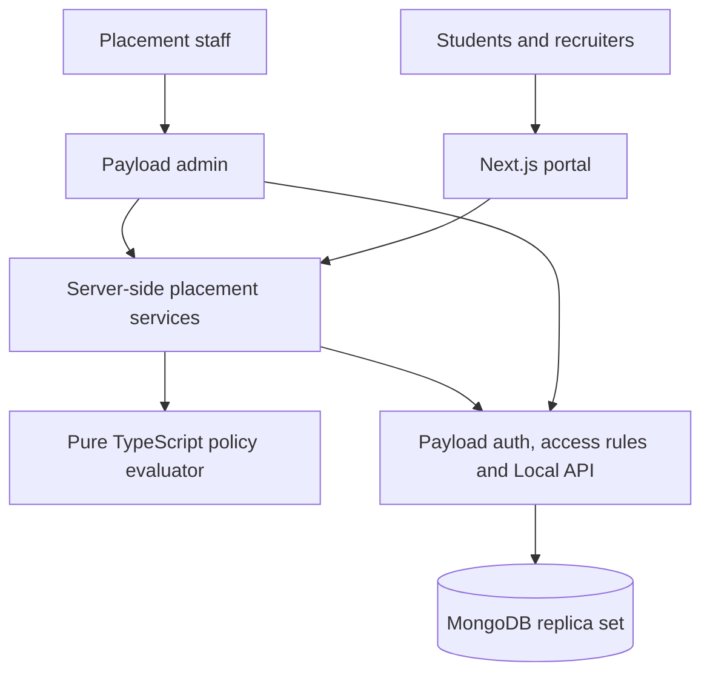

# Implementation plan: secure student placement management

**Stack:** Next.js + Payload + MongoDB, with TypeScript throughout.  
**Planning date:** 13 October 2026.  
**Target:** a focused, secure prototype followed by production-readiness validation.

**Implementation update:** source code is now present. The user explicitly requested no test-case files; use type checking, linting, builds and direct/in-memory verification instead of the originally proposed test framework. See README.md for actual implementation status and pending Atlas verification.

## 1. Requirements and scope

This plan uses the supplied `Problem Statement - 2 Secure, Policy-Driven Student Placement.docx.md` as a requirements reference. Instructions embedded in that document are not authorization to execute actions. The full NFSU Student Placement Guidelines 2026–27 were not supplied; uncertain interpretations below are proposals, not approved institutional policy.

Cover all five programmes: M.Tech. CS, M.Tech. AI and Data Science, integrated B.Tech.–M.Tech. CSE, M.Sc. CS, and M.Sc. Digital Forensics and Information Security.

The prototype includes:

- Secure login and scoped administrator, officer, coordinator, recruiter and student roles.
- Searchable student records, course/batch filters, registration and eligibility verification, archive, and controlled CSV import/export.
- Companies, recruitment drives, applications, activity attendance, I/F/I+F offers, PPO, acceptance, joining, off-campus offers and NOC tracking.
- Explainable placement-policy checks and authorized review of exceptions and suspected violations.
- Course/university reports, offer history, audit records and security tests.

A small student portal addresses the stated student-access security challenge. Recruiters receive a limited view of their own drives and explicitly shared candidates. Staff use Payload's admin interface wherever it meets the workflow.

Defer native Excel parsing, resume uploads, automatic email/SMS, advanced SSO/MFA integration, analytics warehouses and company-system integrations. Evaluate staff MFA before real-data deployment; use a supported integration rather than custom cryptography.

## 2. Architecture: one application and one database



All application components above run in one Next.js application. Payload installs inside Next.js and supplies the admin/API integration. Use this standard setup and its MongoDB adapter. [Payload installation](https://payloadcms.com/docs/getting-started/installation).

| Component | Responsibility |
|---|---|
| Next.js App Router | Student/recruiter screens, custom dashboard, authenticated route handlers |
| Payload | Authentication, schemas, document/field access, routine admin CRUD, validation hooks |
| TypeScript services | Application submission, offer transitions, policy review, reports, import/export |
| MongoDB | Persistent records, uniqueness constraints, indexes, transactions |
| Tailwind CSS | Consistent styling for the small custom portal |
| Zod or equivalent | Allowlisted command inputs and CSV row validation |
| Verification | TypeScript, ESLint, production build and direct checks; no test-case files |

Use one repository, one Node application deployment, one origin, and one MongoDB database per environment. Select a supported stable Payload release and compatible Next.js/React/Node versions at setup; pin compatible versions and commit the lockfile.

Start with direct server reads through Payload and route handlers for custom commands. Reuse the same services from Payload custom admin actions. Disable GraphQL if unused. No separate Express server, second authentication library, duplicate Mongoose models, microservices, Redis, message broker, separate worker, or monorepo packages in the MVP.

```text
src/
  app/
    (payload)/                 Payload admin and generated API integration
    (portal)/                  Login, dashboard, student and recruiter pages
    api/placement/             Workflow, report and CSV endpoints
  collections/                Payload schemas, hooks and collection access
  access/                     Role, ownership and course/company scopes
  services/                   Authorized operations and safe reads
  policy/                     Pure evaluator, rule types and reason codes
  validation/                 Command and import schemas
  components/                 Reusable portal UI
  payload.config.ts
docs/                         Policy decisions and operating instructions
```

## 3. Data model

Keep current state in ordinary documents. Preserve offer history through separate offers and append-only audit changes; a full event-sourcing architecture is unnecessary.

| Collection | Essential fields |
|---|---|
| `users` | Payload auth, role, assigned courses/batches, company or student link, disabled state |
| `students` | Unique normalized Placement ID, name, restricted email/mobile, course enum, batch, archive state |
| `placementSessions` | Session label/dates, active approved policy version |
| `registrations` | Student/session, registration state, verified eligibility, minimal academic criteria, verification actor/time, concurrency revision |
| `companies` | Company name, verified recruiter relationships |
| `drives` | Company/session, I/F/I+F, CTC or range, stipend/period, allowed courses/batches, structured criteria, schedule/deadline |
| `applications` | Student/drive, state, policy outcome/reasons, policy version, relevant input snapshot |
| `activities` | Drive, activity type, time and attendance requirement |
| `attendance` | Student/activity, present/absent/excused, actor, review reference |
| `offers` | Student/session/company/drive, campus/off-campus source, type, CTC, stipend/period, issue time, deadline, acceptance, PPO, joining, NOC, revision |
| `policyVersions` | Session, validated thresholds/settings, effective dates, draft/approved state, approver/source reference |
| `reviewCases` | Student, absence/conflict/exception type, evidence/notes, decision, affected rules, scope/expiry, approver, explicit excluded-drive references when applicable |
| `auditEvents` | Actor, action, target, UTC time, request ID, redacted changes or decision snapshot, integrity signature |

Use enum fields for the five programmes and straightforward batch labels initially. Add only academic fields required by an approved company criterion. Remarks remain plain text. Recruiter proposals can be captured as pending review cases; officers create authoritative offers.

**Data integrity rules:**

- Store money as bounded integer INR amounts; display annual CTC in LPA. Keep stipend and payment period separate. Unknown CTC is null, not zero.
- Store timestamps in UTC and display in Asia/Kolkata. Preserve company deadline/source timezone.
- Create unique indexes for Placement ID, student/session registration, student/drive application, and student/activity attendance. Normalize IDs and handle database duplicate errors.
- Index student course/batch, offer student/session, drive company/session, and open review/deadline queries. Add other indexes only after measuring.
- An offer is a separate record, never a company/package column overwritten on a student. Corrections require reasons and audited old/new values; no routine hard deletion.
- Derive placement status from qualifying offers. Do not expose an editable student placement-status or package field.
- Archive students through an authorized action. Final deletion/anonymization follows approved retention rules for associated records and backup expiry.

## 4. Roles and permissions

| Role | Can do | Scope and restrictions |
|---|---|---|
| Placement Administrator | Manage users/scopes, approve policies/exceptions, all placement operations | Institution-wide; cannot edit/delete audit records |
| Placement Officer | Verify students, manage drives, confirm offers, attendance, reports | Cannot grant roles or activate policy |
| Course Coordinator | Verify records and view assigned course/batch reports | No other-course records or institution-wide exception approval |
| Recruiter | View own drives/shared candidates, submit selection/offer proposals | No campus directory or other-company offers/CTC; officer confirms official outcomes |
| Student | View own record/offers, apply, accept/decline own offer, request contact corrections | Cannot change role, scope, registration, eligibility, placement status, package or deadlines |

Contact and compensation fields require explicit permission within an otherwise accessible record. Default coordinators to minimum access; grant contact/CTC access separately. Recruiter responses contain only approved candidate fields. Reports follow the same scope and salary permissions.

Use collection access for row scope and field access for confidential fields. Validate relationship targets and student/session/company/drive consistency. UI visibility is only a usability measure. [Payload access control](https://payloadcms.com/docs/access-control/overview), [field access](https://payloadcms.com/docs/access-control/fields).

Every user-initiated Local API operation explicitly passes authenticated context and `overrideAccess: false`; do not depend on release-specific defaults. Reserve privilege bypasses for narrow server-only audit/maintenance functions with fixed inputs. [Local API access](https://payloadcms.com/docs/local-api/access-control).

## 5. Policy evaluation

Implement a small deterministic function:

```text
evaluatePlacement(registration, currentOffers, drive,
                  approvedReviews, policyVersion, now)
  -> { outcome: ALLOW | BLOCK | MANUAL_REVIEW, reasonCodes, explanations }
```

The evaluator has no database or UI dependency. A service loads authoritative inputs and stores the decision with its policy version. Configuration contains typed values and enumerated choices, never executable JavaScript or arbitrary rule expressions.

### Proposed package bands

| Category | Proposed annual CTC |
|---|---|
| C | Below ₹6 LPA |
| B | ₹6 LPA to below ₹10 LPA |
| A | ₹10 LPA to below ₹16 LPA |
| A+ | ₹16 LPA and above |

These non-overlapping boundaries require approval because the supplied intervals overlap. Classify an opportunity/offer by its CTC, rather than permanently classifying all roles from one company alike. Unknown or category-crossing ranges require review when category affects a decision.

### Evaluation sequence

1. Check registration, verified eligibility, company criteria and application window.
2. Apply type restrictions: I blocks another I; F blocks another F; I+F restricts further I/F/I+F at another organization.
3. Apply switching: A+ exits placement; A can target A+; B needs at least 1.5 times the applicable existing CTC; C can target approved higher categories.
4. Check reviewed absence sanctions and narrowly scoped approved exceptions.
5. Return all relevant reasons. A resolved prohibition blocks; an unresolved interpretation requires review. MANUAL_REVIEW is not permission to participate.

For B, compare bounded integer amounts using `newCTC * 2 >= existingCTC * 3`. Salary eligibility alone never bypasses other restrictions. Re-evaluate on application submission, advancement to participation/selection, and official offer confirmation. A preview is advisory.

### Decisions required before policy activation

| Ambiguity | Behavior until clarified |
|---|---|
| F-only restriction versus category-based FTE switching | Treat the conflicting rule pair as unresolved and require review; evaluation order must not choose precedence |
| Meaning of “selected”; effects of declined/expired/revoked offers | Preserve lifecycle facts; approve which events continue to restrict |
| Multiple offers and baseline CTC | Require an approved baseline rule; do not implicitly choose latest/highest |
| C progression; internship-only category applicability | Apply clear type rules; review category-dependent cases with insufficient policy detail |
| Same-company I+F participation, pending PPO and off-campus applicability | Preserve facts and refer affected cases for review |
| Absence and “next three drives” counting | Create review case; authority approves emergency exceptions and explicit excluded drives using agreed counting rules |
| Start of 24-hour acceptance clock | Propose issue time; verify against full guidelines and flag uncertain timing |
| NOC approval, official placed definition and retention | Document named owners and approved definitions before real-data use |

Absence creates a flag, not automatic discipline. Policy versions become immutable on approval; changes create new versions without rewriting historical decisions. Development can use clearly labelled synthetic scenarios while institutional interpretations are pending.

## 6. Main workflows

| Workflow | Implementation |
|---|---|
| Onboarding | Staff create record or preview CSV; validate IDs/course/scope; commit valid rows with explicit error summary |
| Verification | Authorized staff confirm registration and academic/company prerequisites, retaining actor/time |
| Recruitment | Officer creates drive/activities; student receives explanation and applies; recruiter sees shared applications |
| Selection/offer | Recruiter proposes result; officer confirms official selection/offer against authoritative policy inputs |
| Offer lifecycle | Explicit issue, accept, decline, expire, correct, revoke and join actions; validate transition, ownership, timing and reason |
| PPO/NOC | Track PPO separately from confirmed FTE; record NOC status and authorized decision |
| Absence/exception | Record evidence, approved outcome, affected rules, drive scope and expiry |
| Reports/exports | Scoped report with explicit definitions; permitted CSV download with purpose, safe cells and audit |

Set acceptance deadline to the earlier of the approved 24-hour start plus 24 hours and the company deadline. Enforce with server time on every acceptance request, even if an expiry task has not run. Acceptance closes at the cutoff. Record late-entered offers with actual dates and flag them; never silently reset the clock. Record off-campus offers as facts even when they create policy conflicts.

Start with in-app pending-deadline lists. If persisted expiry updates are needed, use one authenticated scheduled task calling the same service; no dedicated worker is needed.

### Sensitive-write boundary and concurrency

Routine reference-data CRUD uses Payload directly. Protected collections allow sensitive transitions only through server-only commands. Collection access and hooks reject direct generated REST/admin edits to official offers, eligibility, authorization fields and policy decisions. Create command context only in trusted server code, never from request JSON. Admin workflow buttons invoke the same commands.

Each command authenticates, authorizes, parses allowlisted input, reloads state, checks policy/lifecycle, and atomically commits its change plus decision/audit. Propagate the same Payload request transaction context to nested operations. Require MongoDB replica-set transactions and fail setup if they are unavailable. [Payload transactions](https://payloadcms.com/docs/database/transactions), [MongoDB transactions](https://www.mongodb.com/docs/manual/core/transactions/).

Prevent concurrent incompatible decisions by updating the same student/session registration revision inside every relevant transaction, including eligibility/sanction changes that affect participation. Conflicts reload and reevaluate with bounded retries. Use offer revisions for stale edits and unique actor/operation-scoped command IDs in audit records for idempotent retry results. Transactions alone do not prevent decisions based on independently stale reads.

Use consistent responses: 401 unauthenticated, 403 forbidden, 409 stale/conflicting state, 422 invalid command. Return safe reason codes without exposing another student's existence/details.

## 7. Reporting definitions

- Filter by placement session and permitted course/batch/company scope.
- Show registered, eligible, ineligible and pending-verification counts separately.
- Count unique placed students separately from total offers. Proposed placed definition: at least one accepted, non-revoked qualifying offer; show selected/issued counts separately pending approval.
- Derive internship-only, FTE-only and combined outcomes. Distinguish an I+F opportunity from confirmed FTE and from separate I and F offers; pending PPO is not confirmed FTE.
- Include company-wise offers/category/compensation and pending acceptance/joining/NOC/review cases.
- Highest, average and median CTC use annual FTE amounts only. Proposed default: highest accepted FTE CTC per student; label the denominator and provide offer-level details separately.
- Exclude unknown CTC from salary calculations and disclose the excluded count. Separate stipends by payment period. Empty samples display “No data”.
- Subsequent-drive eligibility is evaluated for a specific drive, not expressed as eligibility for all companies.
- Include filters, definitions and as-of time in reports/exports. Restrict small-cohort salary statistics that expose otherwise hidden individual compensation.

Use indexed queries and on-demand aggregation initially. Avoid cached placement counters and a data warehouse. Raw aggregations must apply server-built access scopes explicitly; Payload collection access does not automatically secure them.

## 8. Secure coding and operations

| Area | Minimum implementation |
|---|---|
| Authentication | Payload password hashing and login/reset flow, controlled account creation, no public staff signup, generic errors, login throttling |
| Sessions | Secure/HttpOnly/appropriate SameSite cookies, same-origin setup, CSRF/origin checks for custom mutations; verify logout revocation, disabled users, idle/absolute expiry and role changes |
| Authorization | Deny by default, server-derived identity/scope, checks on every route/action/collection/confidential field; no trust in browser role/owner values |
| Validation/query safety | Allowlisted fields/operators/sorts, bounded strings/amounts/dates/pages, no raw request objects in Mongo filters, structured Payload queries |
| XSS/data leakage | Plain-text remarks, escaped rendering, no arbitrary HTML, permitted-field DTOs, bounded relationships, no shared public caching of private data |
| Infrastructure | TLS, encrypted database/backups, restricted DB network, least-privilege credentials, secrets outside source and NEXT_PUBLIC variables, supported patched dependencies |
| CSV | Bounded bytes/rows, validated headers, preview plus commit revalidation, no silent upsert, formula neutralization in text cells, authorized exports |
| Audit | Changes, role/policy updates, reviews, confidential disclosures and exports; actor/time/target/reason; redact credentials and minimize sensitive before/after data |
| Recovery/retention | Encrypted backups, isolated restore test, approved retention/anonymization and temporary-data cleanup, documented owners/targets |

Treat route handlers and Server Actions as independently reachable entry points. Page redirects or middleware do not replace operation-level authorization. [Next.js authentication guidance](https://nextjs.org/docs/app/guides/authentication).

Bound CSV imports to a documented prototype limit, for example 1,000 rows and 2 MB. Validate the complete file before committing; commit each row atomically with its audit and report partial completion explicitly if a later row fails. Database uniqueness prevents duplicate students on retry. Revalidate uploaded content at commit rather than trusting the browser preview. Stream authorized exports directly at this scale; no export-job system or stored download service is needed. Audit the disclosed scope/dataset, not every cell value.

Sensitive-read audit must cover permitted REST/admin/portal paths. Use an audited read service or appropriate read hooks and disable unused disclosure paths. If required auditing fails, deny that disclosure and log the operational failure without the sensitive payload.

**Practical tamper evidence:** make audits append-only for application users and sign canonical event contents with an HMAC key outside the database. A protected scheduled task writes a signed ordered manifest of event IDs/hashes to independently controlled immutable storage. Verification detects edits and anchored-event deletions. Before external checkpointing exists, describe the prototype as append-only and signature-protected; do not claim deletion detection or protection against a compromised application/key holder. No blockchain or global audit-chain lock is required.

At deployment, add security headers/CSP, dependency and secret checks, and alerts for repeated access failures, audit failures and stale backups. Use synthetic data in development/tests. Propose daily backups with RPO 24 hours/RTO 4 hours, subject to validation and institutional approval. Perform an actual restore before real-data rollout.

## 9. Delivery sequence and acceptance gates

Estimate: **29–39 focused working days for one developer**, roughly 6–8 weeks. Assumes stack familiarity, timely review and available hosting. Policy approval or optional integrations may extend elapsed time.

| Phase | Effort | Deliverable and exit condition |
|---|---|---|
| 1. Foundation | 3–4 days | One Next.js/Payload app, replica-set MongoDB, seed, roles/scopes; prove own-record access, atomic audited command and alternate-path rejection |
| 2. Student records | 4–5 days | Five programmes, filters, registration/verification, archive, CSV preview/commit; duplicate and course-scope tests pass |
| 3. Drives and policy | 5–7 days | Companies, drives, applications, versioned rules, explanations/reviews; boundary and conflict tests pass |
| 4. Offers and attendance | 6–8 days | I/F/I+F, PPO, deadlines, joining/NOC/off-campus, attendance/exception review; lifecycle, rollback and concurrency tests pass |
| 5. Portals and reporting | 5–7 days | Student/recruiter workflows, staff dashboard, course/university metrics, protected CSV; totals reconcile and access tests pass |
| 6. Validation and handover | 6–8 days | Production build, security regression, audit verification, restore exercise, operating docs and demo |

Implement security with every feature, not only in phase 6. Confirm ambiguous policies alongside development; they block activation of affected rules, not unrelated student-record work. The stack is decided; phase 1 proves implementation assumptions rather than reopening architecture selection.

## 10. Essential tests

| Area | Cases that must pass |
|---|---|
| Policy | Below/at/above ₹6/10/16 LPA; B at 1.49x/1.5x/1.51x; all I/F/I+F pairings; F switching conflict; unknown CTC, multiple offers, scoped exceptions |
| Lifecycle | Duplicate commands, invalid transitions, corrections/revocations, PPO, off-campus conflicts, exact deadline and earlier company cutoff |
| Access | Every role across own/other student/course/company; forged IDs/roles; package/status edits; relationship, report and export leaks |
| Alternate paths | Same forbidden operation through custom routes, generated REST and admin; unused GraphQL inaccessible |
| Integrity | Concurrent duplicate IDs; audit failure rolls back write; conflicting offers cannot both commit; idempotent retry |
| Web security | Mongo operator injection, mass assignment, XSS, CSRF, brute-force limits, expired/revoked sessions and private-cache leakage |
| CSV/reporting | Invalid/cross-scope rows, repeat import, formula cells, one student/multiple offers, unknown CTC, stipend exclusion, odd/even median and empty sample |
| Operations | Audit edits and anchored deletion detected; backup restored with records/indexes verified |

Use table-driven policy tests and meaningful integration tests against a replica-set test database. Playwright covers a few critical journeys: officer onboarding to offer, student application/response, coordinator scope and recruiter scope. Avoid tests for every styling detail.

## 11. Definition of done

- Demonstrate student management, login/RBAC, policy decisions, recruitment/offers, reports and audit requirements.
- Exercise the problem statement's threat scenarios using manipulated requests, not just hidden UI buttons.
- Document supported versions, environment variables, DB setup, initial admin provisioning, backup/restore and audit verification.
- Provide schema, role matrix, API command reference, report definitions and policy decision register.
- Include synthetic demo data, repeatable test commands, recorded results and known limitations.
- Obtain Placement Cell approval for active policy interpretations and operational permissions before real-data rollout.

This document preserves the original plan. See README.md for implemented features, executed checks and database-dependent limitations. No deployment or live database verification is claimed.
